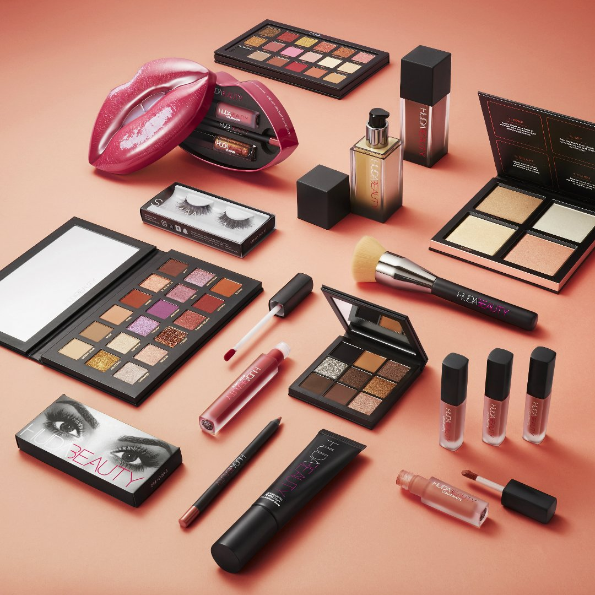
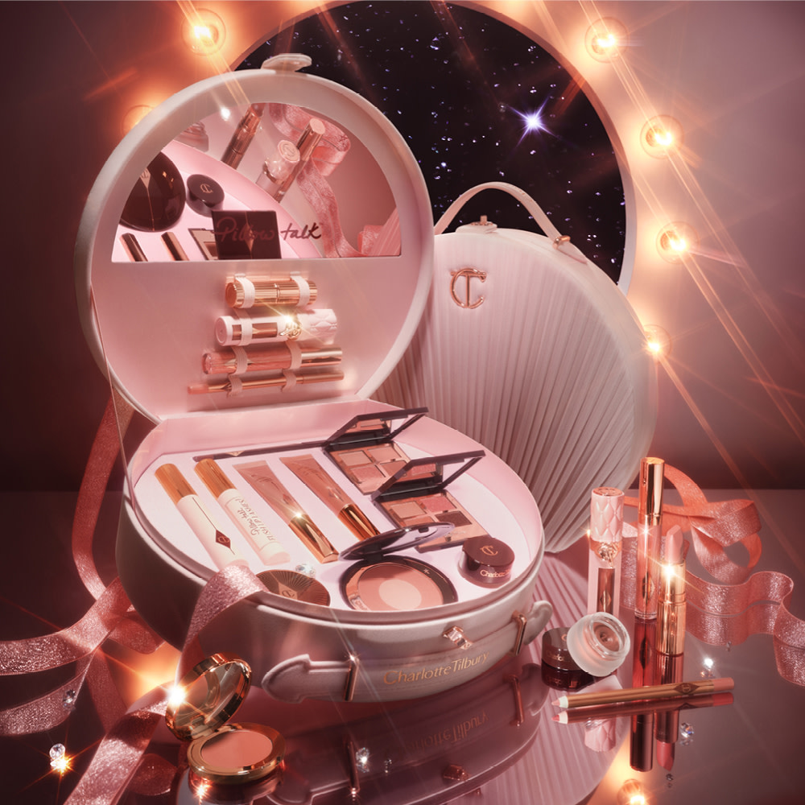

MAKE-UP

 Despre proiect:

Acest proiect este dedicat universului machiajului, produselor cosmetice și tehnicilor de înfrumusețare. Scopul său este de a prezenta importanța machiajului, principalele categorii de produse și brandurile apreciate în industria beauty.

Machiajul reprezintă o formă de exprimare personală, creativitate și încredere în sine.

 Categorii de produse:

Produs

Primer

Foundation

Concealer

Powder

Blush

Highlighter

Mascara

Lip Gloss

Branduri cunoscute:

1. Huda Beauty

Brand cunoscut pentru produsele sale de machiaj, paletele de farduri și pudrele de fixare.

Website: https://hudabeauty.com/

2. Rare Beauty

Un brand apreciat pentru produsele sale cremoase, blush-uri și conceptele de frumusețe naturală.

Website: https://www.rarebeauty.com/

3. Fenty Beauty

Un brand recunoscut pentru diversitatea nuanțelor fondurilor de ten și produsele inovatoare.

Website: https://fentybeauty.com/

4. Charlotte Tilbury

Brand specializat în produse premium pentru machiaj și îngrijirea tenului.

Website: https://www.charlottetilbury.com/

5. Patrick Ta

Brand cunoscut pentru produsele sale profesionale, în special blush-uri și produse pentru ten.

Website: https://patrickta.com/

 Stiluri de machiaj

Natural Makeup – machiaj discret, potrivit pentru fiecare zi.

Soft Glam – machiaj elegant, cu tonuri calde și luminozitate.

Full Glam – machiaj intens, cu accent pe ochi și contur.

Clean Girl Makeup – aspect proaspăt și natural.

Evening Makeup – machiaj sofisticat, potrivit pentru evenimente.

 

 Obiectivele proiectului

Descoperirea produselor cosmetice și a utilizării lor.

Cunoașterea brandurilor importante din industria beauty.

Înțelegerea etapelor realizării unui machiaj.

Organizarea informațiilor într-o pagină Markdown.

Utilizarea titlurilor, listelor, tabelelor, imaginilor și linkurilor.

💗 Concluzie

Make-up-ul este mai mult decât o rutină de înfrumusețare. Este o formă de artă prin care fiecare persoană își poate exprima stilul și personalitatea.

Acest proiect îmbină pasiunea pentru frumusețe cu utilizarea tehnologiilor digitale și a instrumentelor de dezvoltare web.
